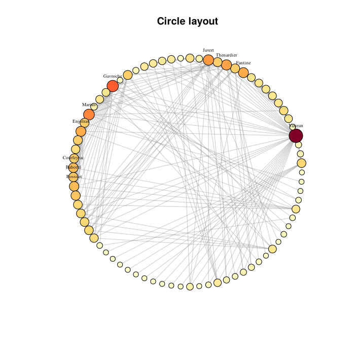
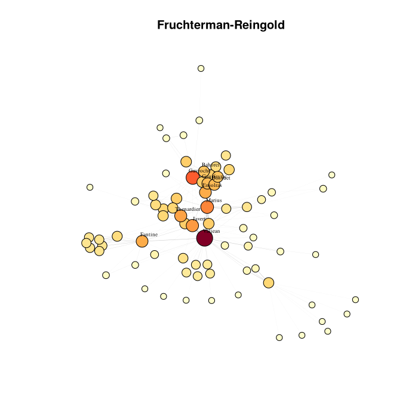
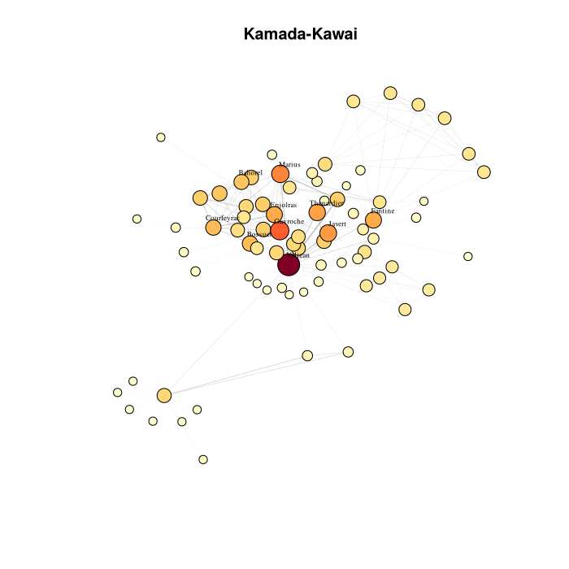
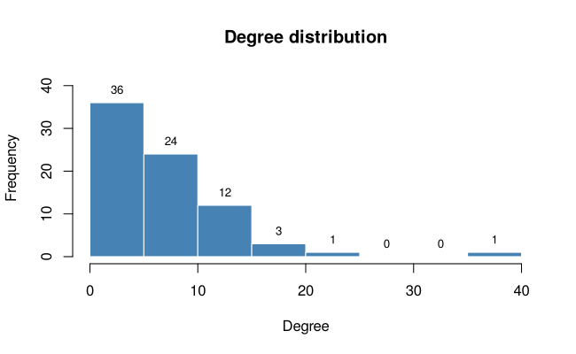
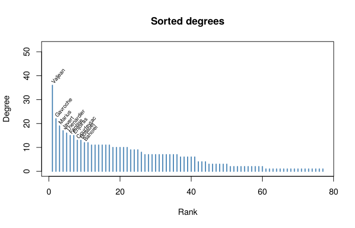
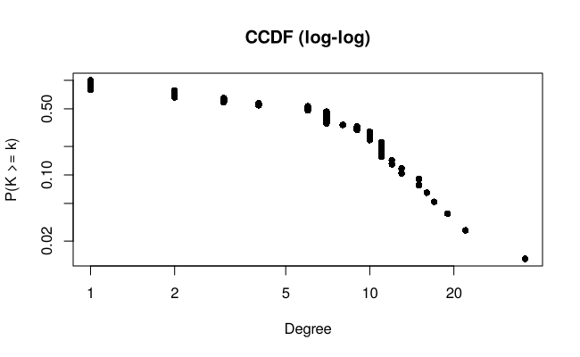
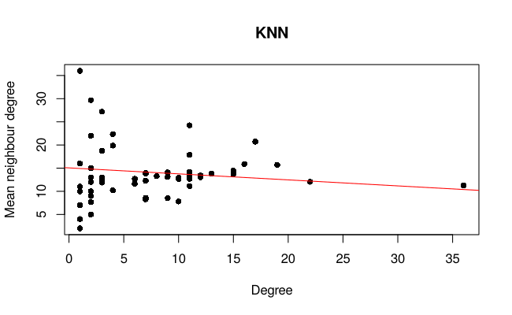
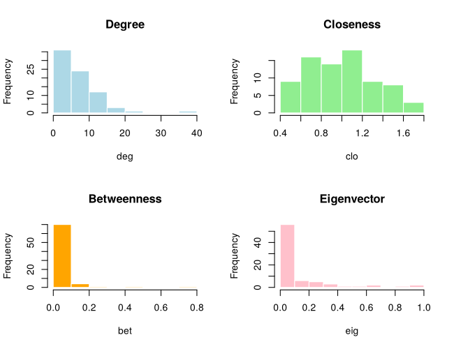
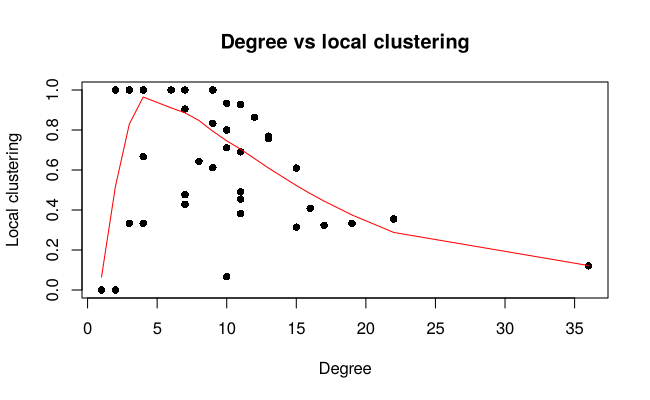
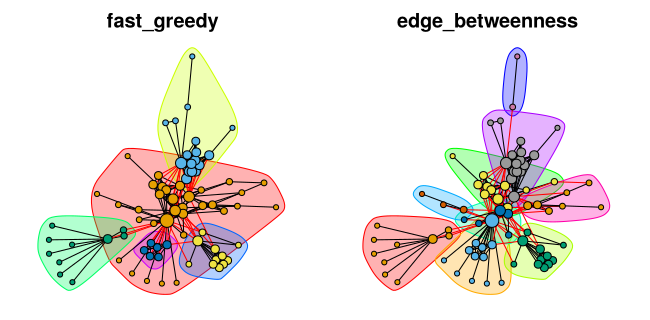

Les Misérables co-appearance network
================

A descriptive network analysis of the character co-appearance network in
Victor Hugo’s *Les Misérables* (Knuth, 1993; KONECT `moreno_lesmis`),
done in R with `igraph`. It covers representations, layouts, degree
distribution, centrality, clustering and cliques, global structure,
community detection and assortativity.

*Coursework for Data Science Applications, MSc in Statistical Sciences,
University of Bologna, by **Mohammadmahdi Ameridaragheh and Hiteshkumar
Vikeshkumar Sabhani**. To reproduce it, run
`rmarkdown::render("README.Rmd")`.*

# Introduction

This report presents a descriptive network analysis of the Les
Misérables character co-appearance network, taken from the KONECT
repository (`moreno_lesmis`,
<http://konect.cc/networks/moreno_lesmis/>). Each node in the network
represents a character in Victor Hugo’s novel, and an edge connects two
characters who appear together in at least one chapter. The edge weight
counts the number of chapters in which the two characters co-appear, so
a higher weight indicates a stronger association between two characters.

The analysis follows the workflow *Describe -\> Visualize -\>
Characterize -\> Interpret*. We first describe the basic properties of
the network and its representations, then we explore its structure
through visualization and degree analysis. After that we look at
node-level centrality, local clustering, global structure, and community
detection, and we close with an assessment of assortativity and an
overall interpretation.

``` r
library(igraph)
library(RColorBrewer)

set.seed(1234)
```

# Defining the Network

## What the network represents

- **Nodes**: characters in *Les Misérables*.
- **Edges**: two characters share an edge if they co-appear in at least
  one chapter.
- **Edge weights**: number of chapters of co-appearance, so larger
  weights mean stronger association.

The network is **undirected** (co-appearance is symmetric) and
**weighted**.

## Loading the data

``` r
file_path <- "lesmis_edges.txt"

edges <- read.table(file_path, header = FALSE, comment.char = "%",
                    stringsAsFactors = FALSE)
colnames(edges) <- c("from", "to", "weight")

g <- graph_from_data_frame(edges, directed = FALSE)
E(g)$weight <- edges$weight
if (!is_simple(g)) g <- simplify(g, edge.attr.comb = list(weight = "sum"))
```

## Basic properties

The five lines below give the headline numbers: how many nodes and edges
the graph contains, whether it is directed, whether it is weighted, and
whether it is simple.

``` r
vcount(g)
```

    ## [1] 77

``` r
ecount(g)
```

    ## [1] 254

``` r
is_directed(g)
```

    ## [1] FALSE

``` r
is_weighted(g)
```

    ## [1] TRUE

``` r
is_simple(g)
```

    ## [1] TRUE

The network has 77 nodes and 254 edges. As expected it is undirected and
weighted, and after `simplify()` it is also simple (no self-loops or
parallel edges). Co-appearance being symmetric means an undirected
representation is the natural choice. The weight attribute lets us move
beyond pure topology and account for how strong each association is.

One limitation of the data is that co-appearance in a chapter is a
fairly loose proxy for the actual relationship between two characters.
Two characters can share many chapters without really interacting, while
two others may have a single but very meaningful encounter. The network
is also limited to characters that appear in the novel, so any external
context is left out. Another small caveat is that the KONECT file labels
nodes with integer IDs rather than character names, so throughout this
report we apply the Knuth (1993) name mapping defined below.

# Network Representations

## Edge list

The first few rows of the edge list show how the network is stored
internally: each row is one edge, with its endpoints and weight.

``` r
head(as_data_frame(g, what = "edges"))
```

    ##   from to weight
    ## 1    1  2      1
    ## 2    2  3      8
    ## 3    2  4     10
    ## 4    2  5      1
    ## 5    2  6      1
    ## 6    2  7      1

## Adjacency matrix

``` r
A <- as_adjacency_matrix(g, attr = "weight", sparse = TRUE)
dim(A)
```

    ## [1] 77 77

``` r
# Sparsity: fraction of zero entries in the adjacency matrix
1 - (length(A@x) / (vcount(g)^2))
```

    ## [1] 0.9143194

The adjacency matrix is 77 by 77, and about 91% of its entries are zero.
This matches the density value we report later in the Global Structure
section, since for an undirected simple graph sparsity and density add
up to roughly one.

This is the typical situation for a real-world network. The number of
possible edges in a graph grows quadratically with the number of nodes,
but the number of edges that actually form is constrained by the cost of
each connection: time, attention, narrative space, energy, money, and so
on. As networks get larger, the gap between possible edges and realised
edges grows wider, so densities shrink and sparsity grows. Social,
biological and technological networks all show this pattern.

The two representations have complementary strengths. The edge list is
compact, since it only records the edges that actually exist: in our
case that is 254 rows, compared to the 77 x 77 = 5929 cells of the dense
matrix. It is also the natural format for storing data on disk and for
reading it in. The adjacency matrix, on the other hand, makes
neighbourhood queries immediate and is the natural input for spectral
methods like eigenvector centrality. Storing it as a sparse matrix
preserves these advantages without paying the memory cost of all the
empty cells.

# Visualization

We compare three different layout algorithms to see which one is most
informative.

``` r
deg <- degree(g)

# Character name lookup (Knuth 1993 node numbering, matches KONECT file)
char_names <- c(
  "1"="Myriel",        "2"="Napoleon",        "3"="MlleBaptistine",
  "4"="MmeMagloire",   "5"="CountessDeLo",    "6"="Geborand",
  "7"="Champtercier",  "8"="Cravatte",         "9"="Count",
  "10"="OldMan",       "11"="Valjean",         "12"="Labarre",
  "13"="Marguerite",   "14"="MmeDeR",          "15"="Isabeau",
  "16"="Gervais",      "17"="Tholomyes",       "18"="Listolier",
  "19"="Fameuil",      "20"="Blacheville",     "21"="Favourite",
  "22"="Dahlia",       "23"="Zephine",         "24"="Fantine",
  "25"="MmeThenardier","26"="Thenardier",      "27"="Cosette",
  "28"="Javert",       "29"="Fauchelevent",    "30"="Bamatabois",
  "31"="Perpetue",     "32"="Simplice",        "33"="Scaufflaire",
  "34"="Woman1",       "35"="Judge",           "36"="Champmathieu",
  "37"="Brevet",       "38"="Chenildieu",      "39"="Cochepaille",
  "40"="Pontmercy",    "41"="Boulatruelle",    "42"="Eponine",
  "43"="Anzelma",      "44"="Woman2",          "45"="MotherInnocent",
  "46"="Gribier",      "47"="Jondrette",       "48"="MmeBurgon",
  "49"="Gavroche",     "50"="Gillenormand",    "51"="Magnon",
  "52"="MlleGillenormand","53"="MmePontmercy", "54"="MlleVaubois",
  "55"="LtGillenormand","56"="Marius",         "57"="BaronessT",
  "58"="Mabeuf",       "59"="Enjolras",        "60"="Combeferre",
  "61"="Prouvaire",    "62"="Feuilly",         "63"="Courfeyrac",
  "64"="Bahorel",      "65"="Bossuet",         "66"="Joly",
  "67"="Grantaire",    "68"="MotherPlutarch",  "69"="Gueulemer",
  "70"="Babet",        "71"="Claquesous",      "72"="Montparnasse",
  "73"="Toussaint",    "74"="Child1",          "75"="Child2",
  "76"="Brujon",       "77"="MmeHucheloup"
)

V(g)$char_name <- char_names[V(g)$name]
V(g)$size      <- 3 + 1.5 * sqrt(deg)

# Label only the top 10 nodes by degree (fewer labels = less overlap)
top10_idx <- order(deg, decreasing = TRUE)[1:10]
V(g)$label <- NA
V(g)$label[top10_idx] <- V(g)$char_name[top10_idx]

V(g)$color <- colorRampPalette(brewer.pal(9, "YlOrRd"))(100)[
  as.numeric(cut(deg, 100))
]
```

``` r
plot(g,
     layout              = layout_in_circle(g),
     main                = "Circle layout",
     vertex.label.cex    = 0.55,
     vertex.label.dist   = 1.2,
     vertex.label.degree = -pi/2,
     vertex.label.color  = "black",
     edge.color          = adjustcolor("grey60", alpha.f = 0.5))
```

<div class="figure" style="text-align: center">


<p class="caption">
Circle layout.
</p>

</div>

``` r
plot(g,
     layout             = layout_with_fr(g),
     main               = "Fruchterman-Reingold",
     vertex.label.cex   = 0.55,
     vertex.label.dist  = 1.0,
     vertex.label.color = "black",
     edge.width         = E(g)$weight / max(E(g)$weight) * 2,
     edge.color         = adjustcolor("grey60", alpha.f = 0.5))
```

<div class="figure" style="text-align: center">


<p class="caption">
Fruchterman-Reingold layout.
</p>

</div>

``` r
plot(g,
     layout             = layout_with_kk(g),
     main               = "Kamada-Kawai",
     vertex.label.cex   = 0.55,
     vertex.label.dist  = 1.0,
     vertex.label.color = "black",
     edge.width         = E(g)$weight / max(E(g)$weight) * 2,
     edge.color         = adjustcolor("grey60", alpha.f = 0.5))
```

<div class="figure" style="text-align: center">


<p class="caption">
Kamada-Kawai layout.
</p>

</div>

In all three plots node size is proportional to degree and color encodes
the same quantity. To keep the figures readable we only label the top 10
nodes by degree, using character names from the Knuth (1993) mapping.

The circle layout treats every node the same and forces the structure to
be read from the edges alone. The Fruchterman-Reingold layout pulls
densely connected groups together and pushes weakly connected ones
apart. The Kamada-Kawai layout uses path distances and tends to place
the hubs in the centre.

Looking at our specific plots, the Fruchterman-Reingold layout reveals
the structure best. Circle hides the community structure behind a tangle
of chords, and Kamada-Kawai compresses the periphery. Only
Fruchterman-Reingold pulls the densely connected sub-groups into
visually separable clouds.

Three patterns are robust across all three layouts. First, one very
large hub (Valjean) is visibly the most connected node in every plot.
Second, the network has one connected piece: no isolated nodes drift
away from the main mass. Third, the high-degree characters cluster near
each other regardless of the algorithm. These three features are real
properties of the data.

The remaining differences between the layouts are artifacts of the
algorithms. The exact angular position of a peripheral node, the overall
rotation of the layout, and the distance between two nodes that are not
directly connected all change from one plot to another and should not be
read as informative.

# Connectivity Distribution

## Summary

``` r
summary(deg)
```

    ##    Min. 1st Qu.  Median    Mean 3rd Qu.    Max. 
    ##   1.000   2.000   6.000   6.597  10.000  36.000

## Distribution plots

``` r
h <- hist(deg, plot = FALSE)
hist(deg, col = "steelblue", border = "white",
     main = "Degree distribution", xlab = "Degree",
     ylim = c(0, max(h$counts) * 1.15))
text(h$mids, h$counts, labels = h$counts, pos = 3, cex = 0.8, col = "black")
```

<div class="figure" style="text-align: center">


<p class="caption">
Degree distribution with frequency counts.
</p>

</div>

``` r
sd <- sort(deg, decreasing = TRUE)
ymax <- max(sd) * 1.45

plot(sd, type = "h", lwd = 2, col = "steelblue",
     main = "Sorted degrees", xlab = "Rank", ylab = "Degree",
     ylim = c(0, ymax))

# Label top 10 with rotated character names
top_n      <- 10
top_names  <- char_names[names(sd)[1:top_n]]
text(x = 1:top_n, y = sd[1:top_n] + max(sd) * 0.03,
     labels = top_names,
     cex = 0.65, srt = 50, adj = c(0, 0.5), col = "black")
```

<div class="figure" style="text-align: center">


<p class="caption">
Sorted degrees with top 10 characters labelled.
</p>

</div>

``` r
x <- sort(deg)
y <- 1 - (seq_along(x) - 1) / length(x)
plot(x, y, log = "xy", pch = 16,
     main = "CCDF (log-log)", xlab = "Degree", ylab = "P(K >= k)")
```

<div class="figure" style="text-align: center">


<p class="caption">
Complementary CDF (log-log).
</p>

</div>

The distribution is clearly skewed. Most characters appear with only a
small number of others, while a few characters appear with many. The
histogram shows the frequencies directly on each bar: the lowest-degree
bin contains 36 of the 77 characters, while only a single character
(Valjean) reaches a degree above 30. The sorted-degrees plot makes the
same point at the level of individual characters and identifies the top
10 by name, and the log-log CCDF makes the heavy tail visible on a
different scale. This is the typical “few hubs, many low-degree nodes”
pattern that comes up in many real-world networks.

## Local assortativity (KNN)

``` r
knn_res <- knn(g)
plot(deg, knn_res$knn, pch = 16,
     xlab = "Degree", ylab = "Mean neighbour degree", main = "KNN")
abline(lm(knn_res$knn ~ deg), col = "red")
```

<div class="figure" style="text-align: center">


<p class="caption">
Average neighbour degree vs degree.
</p>

</div>

The KNN plot shows the average degree of a node’s neighbours against the
node’s own degree. The trend line slopes downward, which means that
higher-degree characters tend to associate with lower-degree characters
rather than with other hubs. The network is therefore locally
disassortative at this level of resolution, and we will see this
confirmed globally in the Assortativity section.

# Centrality

## Computing the four centralities

``` r
# igraph reads `weight` as DISTANCE in closeness/betweenness, so we invert
w_dist <- 1 / E(g)$weight

clo   <- closeness(g, weights = w_dist, normalized = TRUE)
bet   <- betweenness(g, weights = w_dist, normalized = TRUE)
eig   <- eigen_centrality(g, weights = E(g)$weight)$vector
str_v <- strength(g, weights = E(g)$weight)

cent <- data.frame(name = V(g)$name,
                   character = V(g)$char_name,
                   degree = deg, strength = str_v,
                   closeness = clo, betweenness = bet, eigenvector = eig)
```

A note on weights: in `igraph`, the `weight` edge attribute is
interpreted as a *distance* for path-based measures like closeness and
betweenness, i.e. a higher weight means a longer path. In our case
higher weights mean a *stronger* connection, so we invert them
(`1 / weight`) when computing closeness and betweenness. Eigenvector
centrality and strength use the raw weights, which is what we want.

## Distributions

``` r
par(mfrow = c(2, 2))
hist(deg, col = "lightblue",  main = "Degree", border = "white")
hist(clo, col = "lightgreen", main = "Closeness", border = "white")
hist(bet, col = "orange",     main = "Betweenness", border = "white")
hist(eig, col = "pink",       main = "Eigenvector", border = "white")
```

<div class="figure" style="text-align: center">


<p class="caption">
Distributions of the four centrality measures.
</p>

</div>

``` r
par(mfrow = c(1, 1))
```

## Top nodes by each centrality

The four tables below list the ten highest-ranked nodes for each
centrality measure, showing character names rather than raw node IDs.

``` r
head(cent[order(-cent$degree),      c("character", "degree")],      10)
```

    ##     character degree
    ## 11    Valjean     36
    ## 49   Gavroche     22
    ## 56     Marius     19
    ## 28     Javert     17
    ## 26 Thenardier     16
    ## 24    Fantine     15
    ## 59   Enjolras     15
    ## 63 Courfeyrac     13
    ## 65    Bossuet     13
    ## 64    Bahorel     12

``` r
head(cent[order(-cent$closeness),   c("character", "closeness")],   10)
```

    ##       character closeness
    ## 11      Valjean  1.689787
    ## 56       Marius  1.648159
    ## 27      Cosette  1.640597
    ## 28       Javert  1.564038
    ## 26   Thenardier  1.531357
    ## 63   Courfeyrac  1.490462
    ## 24      Fantine  1.474822
    ## 50 Gillenormand  1.474111
    ## 59     Enjolras  1.437399
    ## 29 Fauchelevent  1.411300

``` r
head(cent[order(-cent$betweenness), c("character", "betweenness")], 10)
```

    ##           character betweenness
    ## 11          Valjean  0.79464912
    ## 56           Marius  0.49894737
    ## 2          Napoleon  0.22385965
    ## 24          Fantine  0.19333333
    ## 63       Courfeyrac  0.17666667
    ## 26       Thenardier  0.17187135
    ## 49         Gavroche  0.10245614
    ## 52 MlleGillenormand  0.07754386
    ## 59         Enjolras  0.05590643
    ## 29     Fauchelevent  0.05228070

``` r
head(cent[order(-cent$eigenvector), c("character", "eigenvector")], 10)
```

    ##     character eigenvector
    ## 11    Valjean   1.0000000
    ## 56     Marius   0.9189047
    ## 27    Cosette   0.8211959
    ## 59   Enjolras   0.6711264
    ## 63 Courfeyrac   0.6197220
    ## 60 Combeferre   0.5204232
    ## 65    Bossuet   0.4855304
    ## 28     Javert   0.3974399
    ## 49   Gavroche   0.3588535
    ## 26 Thenardier   0.3392336

## Agreement between rankings

``` r
round(cor(cent[, c("degree","strength","closeness","betweenness","eigenvector")],
          method = "spearman"), 2)
```

    ##             degree strength closeness betweenness eigenvector
    ## degree        1.00     0.95      0.85        0.59        0.89
    ## strength      0.95     1.00      0.93        0.62        0.87
    ## closeness     0.85     0.93      1.00        0.68        0.90
    ## betweenness   0.59     0.62      0.68        1.00        0.66
    ## eigenvector   0.89     0.87      0.90        0.66        1.00

The four centrality measures answer slightly different questions. Degree
counts how many direct neighbours a node has. Closeness measures how
short the average distance is from a node to all others. Betweenness
counts how often a node sits on the shortest path between two other
nodes, so it captures the role of structural bridges. Eigenvector
centrality rewards nodes that are connected to other well-connected
nodes, so it captures a sense of “influence by association”.

Looking at the four tables, Valjean dominates every ranking. He is first
by degree, first by closeness, first by betweenness and first by
eigenvector centrality, which identifies him as the unambiguous main hub
of the network. Marius is second on closeness, betweenness and
eigenvector centrality (and third on degree, behind Gavroche), so he
acts as a secondary protagonist that shares the spotlight with Valjean.

Napoleon is interesting. He ranks third on betweenness but does not
appear in the top ten on degree at all. This pattern is the signature of
a structural broker: a character with relatively few direct connections,
but positioned on many of the shortest paths between other characters.

Cosette and Combeferre are the mirror image: they rank in the top six on
eigenvector centrality but lower on betweenness. They are not bridges
themselves, but they are connected to other influential characters,
which is consistent with belonging to a tight inner circle around the
main hub.

The Spearman correlation matrix supports these readings. Degree,
strength, closeness and eigenvector centrality all correlate above 0.85
with each other, which means they largely agree on who is important.
Betweenness sits apart, correlating only 0.59 to 0.68 with the others.
This confirms that betweenness genuinely captures a different aspect of
importance, while the other three measures are largely interchangeable
indicators of “hub-ness”.

# Clustering and Cliques

## Global and local clustering

``` r
transitivity(g)    # global
```

    ## [1] 0.4989316

``` r
local_clust <- transitivity(g, type = "local", isolates = "zero")
summary(local_clust)
```

    ##    Min. 1st Qu.  Median    Mean 3rd Qu.    Max. 
    ##  0.0000  0.0000  0.6909  0.5731  1.0000  1.0000

``` r
plot(deg, local_clust, pch = 16,
     xlab = "Degree", ylab = "Local clustering",
     main = "Degree vs local clustering")
lo  <- loess(local_clust ~ deg)
ord <- order(deg)
lines(deg[ord], predict(lo)[ord], col = "red")
```

<div class="figure" style="text-align: center">


<p class="caption">
Local clustering against degree.
</p>

</div>

The global clustering coefficient counts the fraction of connected
triples that close into triangles. Local clustering does the same
calculation around each node and tells us how tightly that node’s
neighbourhood is interlinked.

In our network the global clustering coefficient is around 0.50, which
means the network has many triangles and is locally cohesive. Looking at
the scatter plot, lower-degree nodes tend to sit inside small
fully-connected groups (their local clustering is close to 1), while
higher-degree hubs have lower local clustering because their neighbours
don’t all know each other. This is the typical signature of a
hierarchical network.

## Cliques

``` r
table(sapply(cliques(g, min = 3), length))
```

    ## 
    ##   3   4   5   6   7   8   9  10 
    ## 467 639 644 476 252  91  20   2

``` r
lc <- largest_cliques(g)
length(lc[[1]])           # size of the largest clique
```

    ## [1] 10

``` r
char_names[V(g)$name[lc[[1]]]]   # member names of one largest clique
```

    ##           63           49           66           65           64           62 
    ## "Courfeyrac"   "Gavroche"       "Joly"    "Bossuet"    "Bahorel"    "Feuilly" 
    ##           60           59           56           58 
    ## "Combeferre"   "Enjolras"     "Marius"     "Mabeuf"

The clique-size table shows how many cliques exist for each size. There
are several hundred triangles and 4-cliques, and the number of cliques
drops as the size grows, leaving only two cliques of size ten at the
top.

The largest clique we find has size 10, and its members are a group of
characters that almost certainly correspond to a single narrative
episode in the novel, such as the group of revolutionary students at the
barricade, where many characters interact together in the same scene.

# Global Structure

## Density

``` r
edge_density(g)
```

    ## [1] 0.08680793

## Components

``` r
comp <- components(g)
comp$no              # number of components
```

    ## [1] 1

``` r
max(comp$csize)      # size of the largest component
```

    ## [1] 77

## Distances

``` r
mean_distance(g, weights = w_dist)
```

    ## [1] 1.12225

``` r
diameter(g, weights = w_dist)
```

    ## [1] 3.002632

The density is 0.087, which is low: in a network of this size a fully
connected graph would have many more edges. The network has 1 connected
component covering all 77 of the 77 nodes, so there is no fragmentation
and we can talk about distances across the whole network.

Mean distance and diameter are computed using the inverted weights, so
they correspond to weighted shortest paths. Both are small relative to
the number of nodes (mean distance around 1.1, diameter around 3.0),
which is the classic small-world signature: most pairs of characters can
be connected by a short chain of intermediaries. The network is
therefore efficient and sparse at the same time, which is the
combination that defines small-world behaviour.

# Community Detection

We use two methods so we can cross-check the results: fast-greedy
modularity optimisation and edge-betweenness (Girvan-Newman).

``` r
cfg <- cluster_fast_greedy(g, weights = E(g)$weight)
ceb <- cluster_edge_betweenness(g, weights = w_dist)

length(cfg);  modularity(cfg);  sizes(cfg)
```

    ## [1] 5

    ## [1] 0.5472197

    ## Community sizes
    ##  1  2  3  4  5 
    ## 33 17 10 11  6

``` r
length(ceb);  modularity(ceb);  sizes(ceb)
```

    ## [1] 9

    ## [1] 0.5115339

    ## Community sizes
    ##  1  2  3  4  5  6  7  8  9 
    ## 10 12 11 11  5  3  2 16  7

## Visual comparison

``` r
lay <- layout_with_fr(g)
par(mfrow = c(1, 2), mar = c(1, 1, 2, 1))
plot(cfg, g, layout = lay, main = "fast_greedy", vertex.label = NA)
plot(ceb, g, layout = lay, main = "edge_betweenness", vertex.label = NA)
```

<div class="figure" style="text-align: center">


<p class="caption">
Community partitions on the same FR layout.
</p>

</div>

``` r
par(mfrow = c(1, 1))
```

## Agreement between the two partitions

``` r
compare(cfg, ceb, method = "nmi")
```

    ## [1] 0.7341011

Fast-greedy is a fast, agglomerative method that merges nodes to
maximise modularity. Edge-betweenness is a divisive method that
progressively removes the edges most often found on shortest paths. The
two algorithms follow opposite logics, so their level of agreement (here
measured by normalised mutual information) is a useful robustness check.

In our case fast-greedy finds 5 communities with sizes 33, 17, 11, 10,
6, and a modularity of Q = 0.547. Edge-betweenness finds 9 communities
ranging from 2 to 16 members, with a slightly lower modularity of Q =
0.512. Both modularity values are well above what we would expect from a
random graph, so both partitions are meaningful.

The two methods agree at NMI = 0.73, which is substantial overlap. Both
methods identify roughly the same backbone of large groups, but
edge-betweenness additionally splits some of the bigger fast-greedy
communities into smaller pieces. The largest fast-greedy community of 33
nodes broadly corresponds to the main story arc around Valjean, while
the smaller groups appear to map onto narrative sub-plots such as the
revolutionary students, the Thénardier circle, Cosette’s family, and the
Bishop’s group.

# Assortativity

``` r
assortativity_degree(g)
```

    ## [1] -0.1652251

Degree assortativity measures whether nodes tend to connect to other
nodes of similar degree. A positive value means high-degree nodes prefer
to connect to other high-degree nodes (typical of social networks), and
a negative value means high-degree nodes prefer to connect to low-degree
nodes (typical of technological or biological networks).

Our value is around -0.165, which is mildly negative. The network is
therefore disassortative: high-degree characters tend to connect to
low-degree ones rather than to other hubs. This matches what we already
saw in the KNN plot above. It also makes narrative sense, because
Valjean (degree 36) interacts with dozens of minor characters who appear
only briefly, rather than concentrating his interactions on a small
group of equally central figures.

# Conclusions

Coming back to the four questions the workflow asks us to answer:

**How is the network organised?** The network is undirected, weighted,
sparse and entirely contained in a single component. It has a moderately
high clustering coefficient and short average paths, which together
identify it as a small-world network with a clear hierarchical
character.

**Are there key nodes?** Yes. The degree, strength, closeness and
eigenvector centralities all point to Valjean as the dominant hub, with
Marius as the main secondary figure. Betweenness additionally identifies
Napoleon as a structural broker that connects parts of the network even
though he has relatively few direct neighbours. The Spearman
correlations confirm that the four centralities agree on the most
important nodes but disagree on the secondary ranking, which is
consistent with the different aspects of “importance” each measure
captures.

**Is it cohesive or fragmented?** The network is cohesive overall. There
is a clear giant component covering every node, the mean distance is
short, and the global clustering coefficient is high. At the same time
the community detection algorithms identify five to nine sub-groups, so
the cohesion coexists with a clear modular structure.

**Does it show non-random structure?** Yes. The skewed degree
distribution, the high clustering coefficient, the non-trivial
modularity values and the non-zero degree assortativity are all features
that would not be expected in a random graph of the same size and
density. The communities returned by the two algorithms also map onto
narrative groupings in the novel, which gives the structure a clear
interpretation beyond the numbers.
